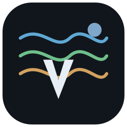
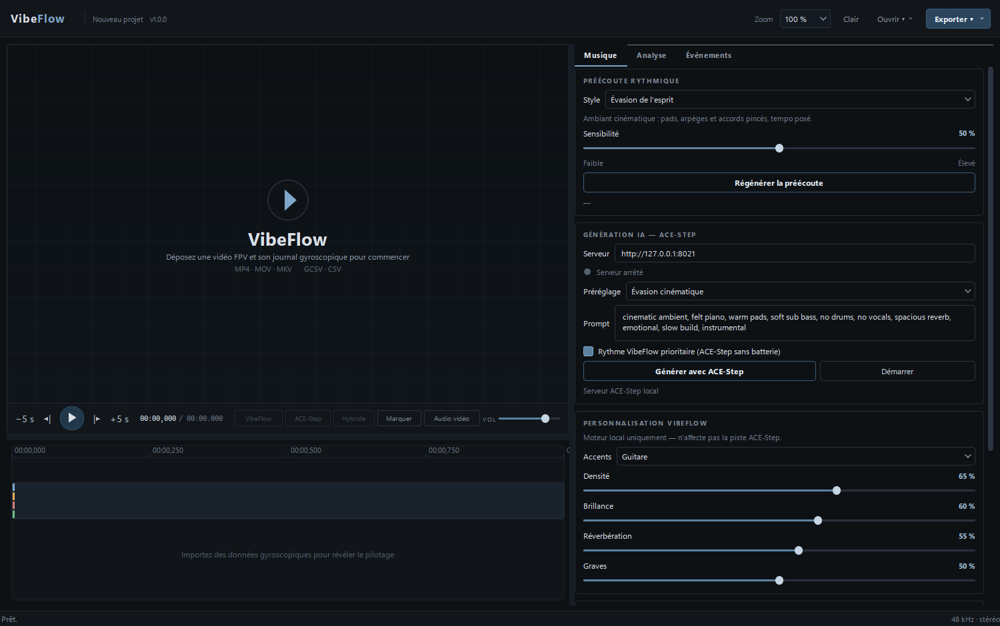
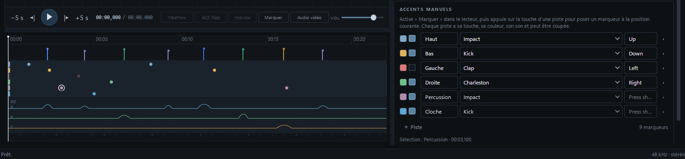
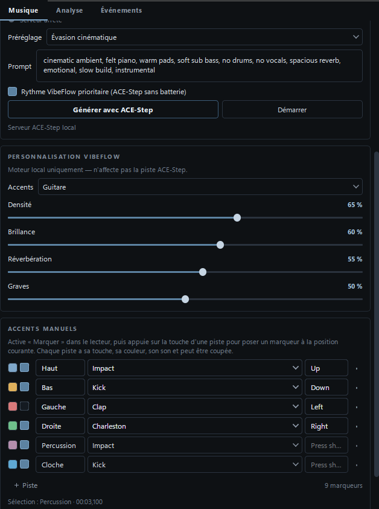
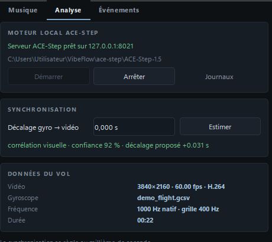

<p align="center">
  
</p>

<h1 align="center">VibeFlow</h1>

<p align="center"><strong>Le pilotage FPV devient musique.</strong></p>

<p align="center">
  
  
  
  
</p>

<p align="center">
  <a href="https://github.com/XRayBarnabey/VibeFlow/releases/latest/download/VibeFlow.exe">
    
  </a>
</p>

<p align="center"><sub>Windows 10/11 · 64 bits · aucun Python ni FFmpeg à installer</sub></p>

VibeFlow est une application de bureau autonome qui analyse les mouvements réels
d'un drone FPV (gyroscope) et les transforme en musique synchronisée avec la
vidéo. Chaque accent tombe sur une figure réellement pilotée : tonneau, flip,
inversion, spin, accélération… dans une grille musicale cohérente (tempo,
sections, densité, basses).

Tout le traitement est **local** : aucune clé API, aucun envoi de vidéo sur un
serveur. La génération musicale IA optionnelle s'exécute sur le GPU de la
machine via un serveur ACE-Step local.



## Sommaire

- [Fonctionnalités](#fonctionnalités)
- [Comment ça marche](#comment-ça-marche)
- [Aperçus](#aperçus)
- [Outils et technologies](#outils-et-technologies)
- [Prérequis](#prérequis)
- [Installation et lancement](#installation-et-lancement)
- [Démarrage rapide](#démarrage-rapide)
- [Génération ACE-Step et VRAM](#génération-ace-step-et-vram)
- [Structure du projet](#structure-du-projet)
- [Tests](#tests)
- [Limites connues](#limites-connues)
- [Crédits](#crédits)

## Fonctionnalités

- **Import vidéo et gyro** : MP4/MOV/MKV, logs GCSV (Gyroflow / RunCam) ou CSV
  générique. Le fichier `.gcsv` posé à côté de la vidéo est détecté
  automatiquement.
- **Synchronisation vidéo ↔ gyro** : corrélation entre le mouvement visuel et la
  vitesse angulaire, proposition automatique et correction manuelle au millième
  de seconde.
- **Analyse du pilotage** : tonneaux, inversions, flips, spins, rotations
  multiples, combinaisons, accélérations, freinages et séquences fluides, avec
  un score de pertinence par figure.
- **Deux styles de composition locale** :
  - *Évasion de l'esprit* : ambiant cinématique, nappes, arpèges, guitare ;
  - *Pulse* : rythmique club, kick four-on-floor, percussions.
- **Personnalisation du moteur local** : 7 kits de percussions, 6 timbres
  d'accents, densité, brillance, réverbération et niveau des graves.
- **Accents manuels** : crée autant de pistes que nécessaire, chacune avec son
  nom, sa touche, sa couleur, son son et son activation. Les marqueurs sont
  posés en temps réel, affichés sur une ligne dédiée, sélectionnables,
  déplaçables au clavier (pas réglable en ms) et supprimables.
- **Génération ACE-Step optionnelle** : VibeFlow installe et pilote lui-même un
  serveur ACE-Step 1.5 local, sans installer l'application ACE Music.
- **Mode hybride** : ACE-Step fournit la nappe harmonique, VibeFlow conserve les
  kicks et impacts exactement sur les figures, avec ducking.
- **Comparateur A/B** : bascule instantanée entre VibeFlow, ACE-Step seul et
  Hybride.
- **Audio vidéo optionnel** : réécoute le son d'origine de la vidéo en même
  temps que la musique.
- **Interface soignée** : thème clair/sombre, zoom 100–150 %, timeline
  gyroscopique, lecteur intégré, progression détaillée (étape, ETA, %).
- **Exports** : WAV de la musique et MP4 avec musique, avec dialogue d'ouverture
  du fichier ou de son emplacement.
- **Projet `.vibeflow`** : vidéo, gyro, réglages, pistes de marqueurs et
  événements désactivés.

## Comment ça marche

1. **Import** — VibeFlow lit la vidéo avec FFprobe et le journal gyroscopique
   avec ses horodatages réels.
2. **Synchronisation** — le mouvement de l'image est corrélé à la vitesse
   angulaire pour estimer le décalage temporel entre les deux sources.
3. **Analyse** — les signaux gyroscopiques sont filtrés puis segmentés pour
   détecter et classifier les figures de vol.
4. **Composition** — un plan rythmique est construit : tempo, sections,
   batterie, basses, nappes et accents placés sur les figures.
5. **Rendu local** — la musique est synthétisée en 48 kHz stéréo et muxée avec
   la vidéo pour la préécoute.
6. **ACE-Step (optionnel)** — la tempo map (durée, BPM, tonalité, sections) est
   envoyée au serveur local ; la piste générée est combinée au rythme VibeFlow.
7. **Accents manuels** — tu ajoutes ou ajustes des marqueurs sur des pistes
   dédiées, avec aperçu sonore immédiat.
8. **Export** — la piste WAV ou la vidéo finale avec musique est écrite sur le
   disque.

La préécoute **n'est pas générée automatiquement** : après l'analyse ou un
changement de réglage, clique sur **Régénérer la préécoute**.

## Aperçus

Timeline, transports et panneaux de personnalisation :



Pistes d'accents manuels et marqueurs colorés sur la timeline :



Analyse du vol et moteur ACE-Step local :



## Outils et technologies

| Outil | Rôle |
|---|---|
| **Python 3.12** | Langage principal |
| **PySide6 / Qt 6** | Interface de bureau, lecteur multimédia, timeline |
| **NumPy / SciPy** | Traitement du signal, analyse gyro, synthèse audio |
| **soundfile** | Lecture/écriture WAV 48 kHz |
| **FFmpeg / FFprobe** | Lecture des médias, mux vidéo + audio, exports |
| **ACE-Step 1.5** | Génération musicale locale optionnelle sur GPU |
| **pytest** | Tests automatisés (61 tests) |
| **PowerShell** | Scripts d'installation, de lancement et de raccourci Windows |

## Prérequis

| Composant | Version | Remarque |
|---|---|---|
| Windows | 10 / 11 | testé sur Windows 11 |
| Python | 3.10 – 3.13 | **3.12 recommandé** |
| FFmpeg + FFprobe | 6.0+ | doivent être dans le `PATH` |
| GPU NVIDIA | optionnel | recommandé pour ACE-Step |
| Espace disque | ~20 Go | uniquement si ACE-Step est installé |

L'exécutable Windows `VibeFlow.exe` ne nécessite ni Python ni FFmpeg : ils sont
embarqués. Les prérequis ci-dessous concernent l'installation depuis les
sources.

Vérification rapide :

```powershell
python --version
ffmpeg -version
ffprobe -version
```

## Plateformes et limites

| Plateforme | État | Limites principales |
|---|---|---|
| **Windows x64** | Support officiel, `.exe` fourni | Exécutable non signé (SmartScreen) |
| **Windows ARM64** | Via l'émulation x64 | Pas de build natif ; ACE-Step CUDA reste x64 |
| **Linux x64** | Depuis les sources | QtMultimedia/GStreamer, FFmpeg ; le backend ACE-Step géré est spécifique à Windows |
| **Linux ARM64** | Expérimental depuis les sources | Wheels PySide6/SciPy, pilotes GPU et ACE-Step à valider |
| **macOS Intel / Apple Silicon** | Depuis les sources, non packagé | Gatekeeper/notarisation, QtMultimedia, backend ACE-Step Windows |
| **Android** | Non supporté | Application desktop, sous-processus FFmpeg, SciPy et ACE-Step local impossibles sans réécriture |

Le cœur d'analyse et de composition est portable. Les limites viennent surtout
de l'empaquetage Qt/FFmpeg, de la signature macOS et du backend ACE-Step local,
qui est aujourd'hui conçu pour Windows. Les versions Linux/macOS pourraient être
ajoutées avec un packaging et des tests dédiés.

## Installation et lancement

### Téléchargement rapide (Windows, recommandé)

Télécharge **`VibeFlow.exe`** depuis la page
[Releases](https://github.com/XRayBarnabey/VibeFlow/releases) et lance-le.
Aucun Python ni FFmpeg à installer : l'exécutable embarque FFmpeg et ffprobe.

Si Windows SmartScreen affiche un avertissement (exécutable non signé),
clique sur **Informations complémentaires** puis **Exécuter quand même**.

L'exécutable fourni est pour **Windows x64**. Windows ARM64 peut exécuter cette
version via l'émulation intégrée (Prism) ; il n'existe pas encore de build natif
ARM64, notamment à cause des dépendances PySide6/SciPy et d'ACE-Step.

La version **x86 32 bits** n'est pas proposée : PySide6, NumPy et SciPy ne
publient plus de wheels 32 bits compatibles avec cette application.

ACE-Step reste optionnel et s'installe depuis l'application si tu veux la
génération IA locale.

### Depuis les sources (Windows)

```powershell
git clone https://github.com/XRayBarnabey/VibeFlow.git
cd VibeFlow
.\scripts\setup.ps1
.\scripts\run.ps1
```

`setup.ps1` crée l'environnement isolé `.venv`, installe les dépendances,
vérifie FFmpeg et crée le raccourci `VibeFlow.lnk` avec l'icône de l'application.

Si PowerShell bloque les scripts :

```powershell
powershell -ExecutionPolicy Bypass -File .\scripts\setup.ps1
```

### Installation manuelle

```powershell
python -m venv .venv
.\.venv\Scripts\python.exe -m pip install -e .
.\.venv\Scripts\python.exe -m vibeflow
```

macOS / Linux :

```bash
python3 -m venv .venv
. .venv/bin/activate
pip install -e .
python -m vibeflow
```

### Construire l'exécutable Windows

```powershell
.\scripts\build_exe.ps1
```

Le script installe PyInstaller, embarque FFmpeg/ffprobe et produit
`dist\VibeFlow.exe`. La configuration se trouve dans `VibeFlow.spec`.

## Démarrage rapide

1. **Importer la vidéo** : sélectionne le MP4. Si `ma_video.gcsv` existe à côté,
   il est chargé automatiquement.
2. **Importer le gyro** si nécessaire (GCSV RunGyro / Gyroflow, CSV générique).
3. Vérifier la **synchronisation** et ajuster le décalage si besoin.
4. Choisir le **style** et les réglages de personnalisation.
5. Cliquer sur **Régénérer la préécoute**.
6. Écouter et comparer avec **VibeFlow / ACE-Step / Hybride**.
7. Optionnel : activer **Marquer** et poser des accents manuels sur les pistes.
8. Exporter en **WAV** ou **MP4**.

Raccourcis utiles : `Espace` lecture/pause, `Ctrl+O` ouvrir, `Ctrl+S`
enregistrer le projet, `Ctrl+R` régénérer, molette sur la timeline = zoom.

## Génération ACE-Step et VRAM

VibeFlow peut installer et piloter automatiquement ACE-Step 1.5 depuis l'onglet
**Analyse → Moteur local ACE-Step**. Aucune installation de l'application ACE
Music n'est nécessaire.

| VRAM | Configuration recommandée |
|---|---|
| ≤ 6 Go | DiT 2B Turbo, LM désactivé |
| **6–8 Go** (RTX 3070) | **2B Turbo + LM 0.6B**, backend `pt`, offload CPU |
| 16–20 Go | 2B SFT ou XL Turbo + LM 1.7B |
| ≥ 20 Go | XL SFT + LM 4B |

Le modèle **XL** n'est pas adapté à 8 Go : il demande environ 12 Go avec
offload et 20 Go sans. Sur une RTX 3070, reste en **2B Turbo**.

Détails, dépannage et réglages : [docs/ACESTEP.md](docs/ACESTEP.md).

## Structure du projet

```
run_vibeflow.py       point d'entrée de l'exécutable Windows
vibeflow/
  app.py              point d'entrée, thème, icône, zoom  core/
    gyro.py           import et rééchantillonnage des logs gyro
    analysis.py       détection et classification des figures
    sync.py           corrélation vidéo ↔ gyro
    rhythm.py         tempo, sections, plan et pistes de marqueurs
    synth.py          synthèse audio 48 kHz
    drums.py          kits de percussions
    project.py        état, cache, génération, export, sauvegarde
  media/ffmpeg.py     FFprobe, mux, export
  providers/acestep.py client REST ACE-Step
  backend/            installation et supervision du serveur ACE-Step
  ui/                 fenêtre, timeline, lecteur, panneaux, thème
tests/                61 tests pytest
docs/                 architecture et guide ACE-Step
tools/                génération de démonstration et d'icône
scripts/              installation, lancement, raccourci Windows, build exe
VibeFlow.spec         configuration PyInstaller (exe Windows)
THIRD_PARTY_NOTICES.md licences FFmpeg, Qt et bibliothèques
```

Architecture détaillée : [docs/ARCHITECTURE.md](docs/ARCHITECTURE.md).

## Tests

```powershell
.\.venv\Scripts\python.exe -m pytest
```

Les tests couvrent l'import GCSV/CSV, les timestamps irréguliers, la détection
sur des figures synthétiques, la synchronisation, la génération musicale, le
rendu audio, le mux FFmpeg, les pistes manuelles et le pipeline complet.

Démonstration reproductible :

```powershell
.\.venv\Scripts\python.exe tools\make_demo.py demo
```

## Limites connues

- La synchronisation automatique est une **proposition** : sur des images peu
  corrélées au mouvement (ciel uniforme, plans fixes), le décalage manuel reste
  la référence.
- La stabilisation Gyroflow n'est pas réimplémentée. VibeFlow peut analyser une
  vidéo déjà stabilisée ou brute.
- Les codecs vidéo exotiques dépendent du backend multimédia Qt/FFmpeg.
- La qualité et la vitesse d'ACE-Step dépendent du GPU et du modèle choisi.
- Le placement des accents ACE-Step n'est pas garanti à ±20 ms ; le mode hybride
  conserve les accents exacts de VibeFlow.

## Crédits

VibeFlow a été conçu et développé avec **DeepSeek V4.1 Flash**, au fil de
nombreuses itérations et améliorations successives : architecture, analyse
gyroscopique, synthèse audio, interface Qt, intégration ACE-Step et finitions.

Les formats et concepts Gyroflow sont utilisés ; aucun code GPL n'est inclus
dans VibeFlow.

Composants tiers et licences : [THIRD_PARTY_NOTICES.md](THIRD_PARTY_NOTICES.md).

## Licence

Projet privé — licence à définir avec l'auteur.
